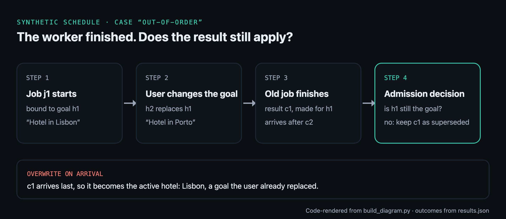

# Stale completions: when an agent finishes yesterday's task

A small, deterministic model of one product question: **what should happen when an async agent's result
arrives after the user corrected or cancelled the goal it was working on?**

"The worker finished" and "this result still applies" are different questions. This repo replays
11 authored synthetic schedules for one fictional travel itinerary under three admission policies and
shows, event by event, what each one makes active.

**Step through it:** [timurista.github.io/stale-completions-demo](https://timurista.github.io/stale-completions-demo/)



## The three policies

| Policy | Rule |
| --- | --- |
| `naive` | The newest arrival becomes the active value. |
| `broken_guard` | Checks that the result's goal is current when it arrives, then writes later without rechecking. Kept as a control. |
| `corrected` | Checks and writes in one non-yielding step against the current goal. Results for replaced goals are kept as *superseded*, for cancelled goals as *cancelled*; two competing corrections are a visible *conflict* until explicitly resolved. |

Every job is bound to the decision (goal) it started under. Decisions name the decision they replace,
and order comes only from those links, never from timestamps. Ticks are integers that order events;
they are not latency.

## Results

From [`results.json`](results.json):

| Policy | Active value correct | Value and receipts correct | Matched its own prediction |
| --- | --- | --- | --- |
| `naive` | 3 / 11 | 1 / 11 | 11 / 11 |
| `broken_guard` | 10 / 11 | 10 / 11 | 11 / 11 |
| `corrected` | 11 / 11 | 11 / 11 | 11 / 11 |

- `broken_guard` fails exactly one case, the check/write race: it checked at tick 3, the user corrected at
  tick 4, and the write at tick 5 made the old result current.
- `corrected` admits a stale result in `missing-update`, because the correction had not reached the
  authority yet. That is recorded as the expected limit, not as prevention.

These are counts over hand-written cases. They are not rates, benchmarks or measurements of any product.

## Run it

Python 3.11+, standard library only, no network.

```sh
python3 experiment.py --fixtures fixtures.json --out results.json   # also writes trace.json
python3 -m unittest discover -p 'test_*.py' -v                      # 19 tests
shasum -a 256 fixtures.json expected.json results.json trace.json   # compare with evidence-hashes.txt
python3 build_review.py && open review.html                          # local stepper
```

Or open the folder in a dev container (`.devcontainer/`, `python:3.11-slim`, no network); the tests run on
create. CI runs the same tests in that image on every push and checks that a fresh run reproduces the
committed `results.json` and `trace.json` byte for byte.

## How it was made

- `fixtures.json` and `expected.json` were written and hashed (`frozen-hashes.txt`) before any policy code
  existed. A test checks those hashes.
- On the first run every policy matched its prediction. Afterwards one metric was added: "active value
  correct", which ignores receipt labels, because `naive` has no receipt vocabulary at all. Both are reported.
- The model, tests, review page and diagram were built with Claude Code from a written brief directed by
  [Tim Urista](https://timurista.ai/about). Visuals are rendered from code or captured from the local review
  page; no image model was used.
- `test-log.txt` and `container-log.txt` are the unedited host and offline-container runs.

## Limits

- One in-process authority. A Python function with no `await` is not distributed atomicity. With several
  writers, the condition has to be enforced where the write happens (a conditional update, compare-and-set,
  a version column).
- Cancelling the view does not stop the worker and does not undo anything a result already did outside the app.
- A correction that hasn't reached the authority can't block a stale result. The product has to notice later
  and say so.
- Inputs are authored and synthetic. Nothing here describes real users, bookings or a production system.

## Related

The idea of versioning per key, keeping superseded records and resolving an active view is from Andrii
Tkachuk's [proposal](https://medium.com/@andrii.tkachuk7/this-is-exactly-the-consistency-problem-i-would-avoid-solving-with-ingestion-time-last-write-wins-1c95d2f672e8)
for agent memory. This repo is not his implementation. Conditional writes and `409 Conflict` are long-standing
practice; nothing here is a new technique.

## License

Apache-2.0
